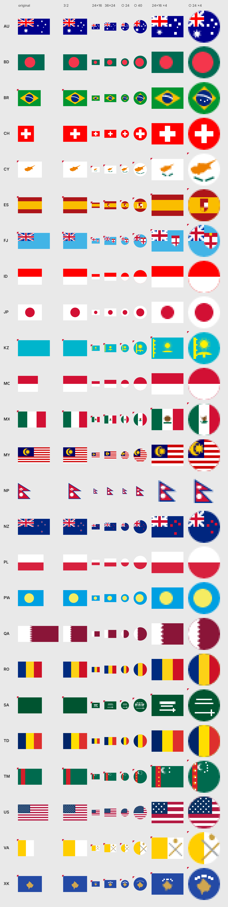

# open-flags (working title) — pilot 0.1

Country flags for interfaces: accurate full-size flags built from each country's law, plus 16/24/40 px miniatures (square, circle and 3:2) drawn for their size under written simplification rules.

This is a pilot of 25 flags, chosen for the hard cases: fine stripes, Union Jack cantons, coats of arms, inscriptions, offset discs, non-rectangular shapes, extreme ratios, ornaments, maps and near-identical pairs. Its job is to test the approach, not to cover every country yet.



A red corner on the sheet marks a draft: an emblem, coat of arms or inscription not yet drawn from the official artwork, or a miniature waiting for review.

## What's inside

```
data/flags/<CODE>.json   metadata: sources with levels, colors with the rule used to pick them,
                         construction numbers, probe points, per-tier simplifications, gaps
data/sources.json        shared sources and the Album 2023 Pantone → RGB table
flags/original/          the ratio set by law
flags/3x2/  flags/1x1/   unified formats
flags/mini/              square-, circle-, rect- at tiers 16, 24, 40
overlays/                1 px outline for flags with white edges, laid on top
docs/                    specification (start with docs/README.md)
src/                     geometry generator from construction numbers, color math and ΔE2000
scripts/                 checks C01–C16, negative tests, contact sheet, Figma export
tools/                   CLDR sync, Figma comparison, confusable-pairs measurement, vexillologist packet
figma.json               Figma file and component sets
```

Figma file: [Open Flags — pilot 0.1](https://www.figma.com/design/WfVWKCZNF2MyqZw7FishR2), 12 `Flag / …` component sets with a `Country` property.

## Commands

Requires Node 20+.

```bash
npm ci
npm run build          # build flags/ from data/ (geometry defined by the law's numbers)
npm test               # checks C01–C16 and negative tests
npm run sheet          # contact sheet at preview/contact-sheet.png
npm run baseline       # snapshot for the C15 visual diff (at release time)
FIGMA_TOKEN=… npm run export:figma   # export from Figma with normalization
```

## Using the flags

- Miniatures are meant to be shown at their own size or an integer multiple (×2, ×3): their edges sit on the pixel grid.
- Flags with a white edge (JP, PL, ID, MC, CY) lose that edge on a white background. Lay `overlays/<format>.svg` on top.
- Some flags cannot be told apart in any format (TD and RO; ID and MC in 3:2 and 1:1). Show the country name or code next to the flag. See `docs/06-confusable-pairs.md`.

## Contributing

Corrections need a primary source (a law, decree, standard or the Album des pavillons). Open an issue with the "Flag is wrong or has changed" template. See `docs/08-contributing.md`.

## License

Artwork and metadata: CC0 1.0. Code: MIT (`LICENSE`, `LICENSE-ARTWORK`). The license covers our drawings; some countries restrict how their state symbols may be used, and CC0 does not change that.
